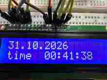
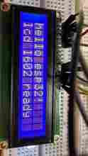
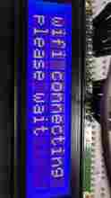
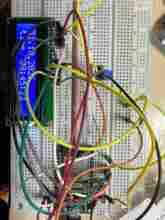
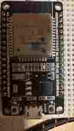
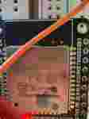
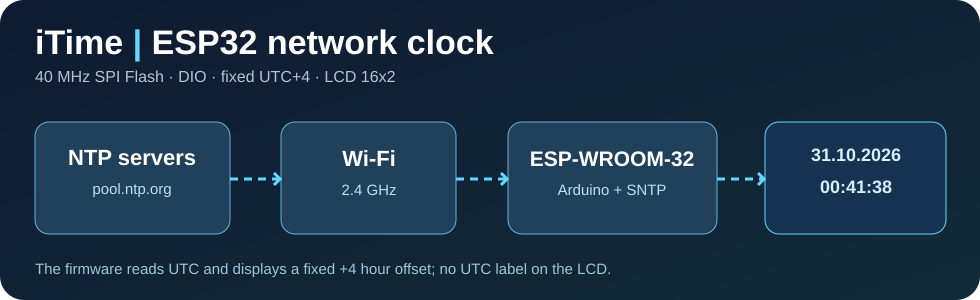

# iTime — From a Two-Line LCD to a Dual-Screen Weather Terminal

**[🇷🇺 Русский](README.md) · 🇬🇧 English**

## 🌦️ Latest field-tested stable version — iTime 2.1

**Verified on real hardware on 4 November 2026:** ESP32-S3 N16R8, two independent 1.8-inch ST7735 TFTs, fixed UTC+4 NTP clock, OpenWeather for Samara, air pressure in mmHg, a local HTTP server and browser dashboard. The second screen displays **weather for 5 minutes, then server status for 5 seconds**. No constant full-screen flicker.

> iTime started as a clock. It acquired two color screens, a weather API, FreeRTOS and a soldering iron. Then a multimeter explained to everyone that debugging a bad jumper wire in software is not a sustainable engineering strategy.

**[📖 Full iTime 2.1 technical guide, pin mapping, PowerShell instructions, HTTP API and sarcastic debugging history](docs/itime-2.1/README.en.md)**  
**[💻 Stable firmware source](firmware/itime_2_1/itime_2_1.ino)** · **[🛡️ TLS trust bundle](firmware/itime_2_1/openweather_ca.h)** · **[🔐 Safe credentials template](firmware/itime_2_1/secrets.example.h)**

The original **iTime 1.0** source and photographs remain intact below. Ubuntu RSS news integration is planned for **iTime 2.2**; no pretending that a roadmap is a release.

---

## 📟 Original iTime 1.0 documentation

# iTime ⏰ — The ESP32 Clock That Survived Its Own Firmware (Barely)

[🇷🇺 Русский](README.md) · **🇬🇧 English**

> **"It's just a clock. How hard can it be?"**  
> Famous last words, right before the ESP32 started throwing **Guru Meditation Errors** like a production server on Friday at 4:59 p.m.
>
> **iTime** is a real, breadboard-built, Wi-Fi-synchronized clock made with an **ESP-WROOM-32** and a **Winstar WH1602A-YGH-CT(K) 16×2 character LCD**. It fetches accurate time over the network using NTP and displays the date and time at a **fixed UTC+4 offset** — without wasting half the LCD on a timezone label. Sixteen characters per line is not a screen. It's a fucking architectural constraint.

**Status:** ✅ A functioning date-and-time display was photographed on the actual hardware. This is not a rendering, not a screenshot from a simulator, and definitely not a successful build log masquerading as a hardware test.

**Critical hardware finding:** This particular ESP32 repeatedly crashed when compiled with **80 MHz SPI Flash**, including **IllegalInstruction** and **LoadStoreAlignment** exceptions. Compiling and flashing with **40 MHz / DIO** let the Wi-Fi test run successfully; the LCD clock subsequently displayed the date and time. This is a verified **workaround on one board**, not a claim that all ESP32 modules require 40 MHz or that the flash chip has been conclusively diagnosed.

## 📸 Real photos, actual wires, actual emotional damage

### The moment the clock finally worked

**31 October 2026, 00:41:38.** The microcontroller finally managed to do what a five-dollar microwave has done for decades. The microwave, admittedly, didn't make us read Xtensa exception dumps first.

### The journey from Hello World to Please Wait Forever

| LCD: "I work." | Wi-Fi: "Have you tried suffering?" |
|---|---|
|  |  |
| **hello esp32!** and **lcd 1602 ready** — the first successful two-line test. | **wifi connecting / please wait** — the screen that became a personality trait while the CPU rebooted. |

### The physical prototype

| Breadboard spaghetti | The ESP32 DevKit | The ESP-WROOM-32 module |
|---|---|---|
|  |  |  |
| "One loose jumper and the timeline collapses." | "GPIO16 is labeled RX2, because naming things once would be too reasonable." | "At 80 MHz I identify as a panic log." |

*All six images above are compressed copies of the owner's actual test photos, committed under [docs/photos/](docs/photos/). They document an experimental breadboard build, **not** a certified, electrically validated wiring reference. The [Russian photo log](docs/photos.md) preserves detailed descriptions. The real photos are supplemented by the [architecture diagram](docs/overview.svg).*

## 😈 Why this project exists

The plan was beautifully stupid:

1. Connect an ESP32 to a 16×2 LCD.
2. Connect to Wi-Fi.
3. Ask an NTP server what time it is.
4. Print the result.
5. Go to bed before midnight.

Reality replied with **a single line of solid LCD blocks**, a spectacularly optimistic **please wait**, and an endless parade of **Guru Meditation Error** messages. The board was not running a clock; it was running a mindfulness retreat for the debugging tools.

The first static LCD test worked. Wi-Fi initialization did not. Removing the LCD entirely did not fix the crash. Changing the flash setting from **80 MHz to 40 MHz** did.

So yes, we built a clock. A clock that knows the time because we first had to learn what **SPI_FAST_FLASH_BOOT**, **clock div:1**, **clock div:2**, **IllegalInstruction**, and **SW_CPU_RESET** mean.

It's a small embedded project with a surprisingly large amount of spite.

## ✅ Features actually implemented in v1

- Network time synchronization through **pool.ntp.org** and **time.google.com** using ESP32's built-in SNTP support.
- A **fixed UTC+4** display offset, with **no daylight-saving adjustments** and no visible "UTC+4" label.
- **Line 1:** date in **DD.MM.YYYY** format.
- **Line 2:** **time HH:MM:SS**, updated continuously.
- **Wi-Fi 2.4 GHz** connectivity and periodic reconnection attempts.
- Local clock time continues to advance after a successful sync even if the network temporarily disappears, as long as the board remains powered. **There is no battery-backed RTC** in this version.
- LCD updates without clearing the entire display on every refresh.
- Serial diagnostic output at **115200 baud**: boot, Wi-Fi attempts, IP after connection, uptime, Wi-Fi status and signal strength.
- Wi-Fi credentials kept in **secrets.h**, excluded from Git via **.gitignore**.
- A repeatable **PowerShell + Arduino CLI** build-and-flash procedure with **FlashFreq=40,FlashMode=dio**.

**Not implemented yet:** weather, RSS headlines, scrolling news, CRMui3 web dashboard, over-the-air updates, offline time retention through power loss. A roadmap is not a changelog; calling these "features" today would be straight-up résumé-driven development.

## 🧰 Hardware / bill of materials

| Part | Prototype specification |
|---|---|
| Microcontroller | **ESP-WROOM-32**, ESP32 DevKit-style breakout, micro-USB |
| Display | **Winstar WH1602A-YGH-CT(K)**, 16 columns × 2 lines |
| Display interface | **16-pin parallel**, operated in **4-bit** mode |
| LCD supply | **5 V**, with shared ground |
| LCD contrast | **10 kΩ potentiometer** |
| Backlight | Pins **A / K**; initial testing used a **330 Ω** series resistor; follow the exact LCD datasheet |
| GPIO level shifting | **Recommended:** a suitable **74HCT245** buffer or **two 74HCT125** devices for six 3.3 V → 5 V signals |
| Networking | 2.4 GHz Wi-Fi router with Internet access |
| Host environment | Windows PowerShell and Arduino CLI |

### ⚠️ A boring safety section, because fried GPIOs aren't funny

ESP32 GPIO outputs are **3.3 V**, while the LCD logic supply in this build is **5 V**. Direct connections may appear to work on one particular LCD controller and fail on another; the photos **do not prove general 3.3 V/5 V logic compatibility**.

For a reproducible design, use an appropriately powered **HCT-level buffer** on all six ESP32→LCD signal lines and wire its output-enable/direction pins as specified by its datasheet. **74HC and 74HCT are not interchangeable for guaranteed 3.3 V-high recognition at a 5 V supply.** Keep a common ground. With **RW tied to GND**, the LCD is used in write-only mode, so it should not drive data back toward ESP32.

Disconnect USB power **before moving jumper wires**. Never connect the LCD's 5 V supply directly to an ESP32 GPIO.

Backlight current depends on the exact LCD variant; **do not blindly short pin A to +5 V**. The 330 Ω resistor is a conservative first test, not a universal production value.

## 🔌 Wiring: 16-pin LCD, no I²C backpack

This prototype uses a direct parallel connection. You **do not need an I²C adapter**.

| LCD pin | LCD label | Connection / function |
|---:|---|---|
| 1 | VSS | GND |
| 2 | VDD | +5 V |
| 3 | VO | Potentiometer wiper (contrast) |
| 4 | RS | GPIO16 (**RX2** silkscreen), via logic-level buffer |
| 5 | R/W | GND (write only) |
| 6 | E | GPIO17 (**TX2** silkscreen), via buffer |
| 7–10 | D0–D3 | Not connected (4-bit mode) |
| 11 | D4 | GPIO18, via buffer |
| 12 | D5 | GPIO19, via buffer |
| 13 | D6 | GPIO21, via buffer |
| 14 | D7 | GPIO22, via buffer |
| 15 | A | LCD backlight anode, current-limited supply |
| 16 | K | LCD backlight cathode, GND |

The firmware constructor matches these **six signal pins**, in the order **RS, E, D4, D5, D6, D7**:

~~~cpp
LiquidCrystal lcd(16, 17, 18, 19, 21, 22);
~~~

Wire the two ends of the 10 kΩ contrast potentiometer between +5 V and GND, and its center/wiper to **VO**.

Refer to [docs/wiring.md](docs/wiring.md) for more wiring detail (Russian). For the love of electronics, verify the actual LCD datasheet and the printed labels on your own module before applying power.

## 🧱 Software, toolchain, core, libraries

| Tool / library | Version / role |
|---|---|
| **Arduino CLI** | **1.5.1** was installed on the test PC |
| **Arduino Core for ESP32** | Platform ID **esp32:esp32**, with **ESP32 Dev Module** board definition |
| **ESP32 core version** | Setup script pins **3.2.1** as a reproducible candidate; this is **not confirmed as the original test machine's exact installed version** |
| **WiFi.h** | Ships with Arduino-ESP32; station mode, connect, reconnect, DHCP, RSSI |
| **time.h** / **configTime()** / **getLocalTime()** | System clock + SNTP time synchronization; no extra RTC library |
| **LiquidCrystal** | Arduino library driving HD44780-compatible character LCDs over a parallel bus |
| **PowerShell** | Sets up the toolchain and invokes compile, upload, and monitor |
| **Serial monitor** | **115200 baud**, debugging only |

There is **no** ArduinoJson, MQTT, external NTP client, HTTP weather client, RTC chip, or CRMui3 in v1. More dependencies would not improve a two-line clock; they would just give the crash dump more friends.

### Flash requirements — READ THIS BEFORE RECREATING OUR PAIN

**Working build configuration on this ESP32:**

| Setting | Value | Explanation |
|---|---|---|
| **FQBN** | **esp32:esp32:esp32** | Generic ESP32 Dev Module |
| **FlashFreq** | **40** | SPI Flash clock = **40 MHz** |
| **FlashMode** | **dio** | Dual-I/O mode for flash |
| **Upload port** | **com3** | USB serial port on the test PC; your port may differ |
| **Monitor baud rate** | **115200** | Serial terminal speed; **not** flash or Wi-Fi speed |
| **Display timezone** | **UTC+4** | Fixed offset, no seasonal changes |

At 80 MHz the boot log showed **mode:DIO, clock div:1**, followed by repeated crashes. At 40 MHz it showed **mode:DIO, clock div:2**, then **wifi mode ok**, **wifi begin called**, DHCP assignment and stable uptime in the observed short test.

**40 MHz is NOT the CPU clock. It is NOT the Wi-Fi data rate. It is NOT the USB flashing baud rate.** It's the frequency at which the ESP32 accesses SPI Flash.

Changing the wrong clock and then complaining about performance is an excellent way to turn a simple project into a doctoral thesis in avoidable mistakes.

## 🚀 Installation — Windows PowerShell, step by step

These commands use the same style as the actual test setup: a project under **c:\users\zhoric\downloads**, using **com3**. Adjust paths/port for your own PC. Commands are lowercase wherever practical; exact Arduino option names retain their required case.

### 1. Clone the project

~~~powershell
cd c:\users\zhoric\downloads
git clone https://github.com/iXimik/iTime.git itime
cd .\itime
~~~

### 2. Install or locate Arduino CLI

~~~powershell
arduino-cli version
arduino-cli board list
~~~

If Arduino CLI was installed by winget but isn't in PATH, and exists in the location used by the original build:

~~~powershell
$env:path += ";c:\program files\arduino cli"
arduino-cli version
~~~

If it is not installed at all:

~~~powershell
winget install --id ArduinoSA.CLI -e
~~~

Restart PowerShell after installation if necessary. **COM3 is not hardcoded in the firmware**; it's just the observed port on the author's Windows machine.

### 3. Install ESP32 support and the LCD library

~~~powershell
arduino-cli config add board_manager.additional_urls https://espressif.github.io/arduino-esp32/package_esp32_index.json
arduino-cli core update-index
arduino-cli core install esp32:esp32@3.2.1
arduino-cli lib install "LiquidCrystal"
arduino-cli core list
~~~

The optional [scripts/setup.ps1](scripts/setup.ps1) performs this setup. The core version is pinned for repeatable installation; record your own verified working core if it differs.

### 4. Add Wi-Fi credentials locally — never commit them

~~~powershell
copy-item .\firmware\itime\secrets.example.h .\firmware\itime\secrets.h
notepad .\firmware\itime\secrets.h
~~~

Edit the two values:

~~~cpp
#define WIFI_SSID "your_2_4ghz_wifi_name"
#define WIFI_PASSWORD "your_wifi_password"
~~~

The file **firmware/itime/secrets.h** is excluded from Git. Don't commit it, paste it into issues, or screenshot it for social media. It takes a special kind of genius to open-source your home Wi-Fi password as a "configuration example."

### 5. Build with the known-working SPI Flash settings

~~~powershell
arduino-cli compile --clean --fqbn "esp32:esp32:esp32:FlashFreq=40,FlashMode=dio" .\firmware\itime
~~~

The exact spelling of **FlashFreq** and **FlashMode** matters. Do not silently fall back to a default 80 MHz build while reproducing this particular board's setup.

### 6. Flash to the ESP32 on COM3

Close any serial monitor first (otherwise the port may be busy):

~~~powershell
arduino-cli upload -p com3 --fqbn "esp32:esp32:esp32:FlashFreq=40,FlashMode=dio" .\firmware\itime
~~~

### 7. Observe the boot sequence

~~~powershell
arduino-cli monitor -p com3 --config baudrate=115200
~~~

To exit the monitor: **Ctrl+C**.

Alternatively, run the build+flash script from the repository root:

~~~powershell
powershell -executionpolicy bypass -file .\scripts\flash.ps1 -port com3
~~~

If you run the last command, review the script and its origin first. It checks for **secrets.h**, builds with the right flash mode, and only uploads after a successful compile.

## 🕒 What appears on the LCD?

Once Wi-Fi and NTP have synced:

~~~text
31.10.2026
time  00:41:38
~~~

The values above are an example taken from a real prototype photo. They are not hardcoded in the firmware.

While attempting Wi-Fi association:

~~~text
wifi connecting
please wait
~~~

After Wi-Fi connects but before time is available:

~~~text
ntp syncing
please wait
~~~

The sketch uses **configTime(4 * 3600, 0, ...)** for fixed UTC+4 and formats the output via **strftime**. It avoids a full **lcd.clear()** on every update. The actual LCD continuously refreshes its date and time.

A second of clock time is cheap. Making it appear on a 16×2 character display apparently requires a multi-stage incident response.

## 🐛 Debugging diary: how the Guru Meditation saga ended

The following sequence is based on **actual serial output from the tested board**, not a contrived example.

### Incident 1 — the LCD displays one row of full blocks

Symptoms: backlight on; **top row entirely filled with rectangular characters, bottom row blank**.

Most likely cause in the original situation: the display had power and contrast but had not been correctly initialized.

After wiring and flashing the basic **LiquidCrystal** sketch, both lines displayed:

~~~text
hello esp32!
lcd 1602 ready
~~~

**Lesson:** a glowing blue display does not mean the data interface works. It means the backlight has excellent self-esteem.

### Incident 2 — adding Wi-Fi causes endless CPU panics

Typical messages:

~~~text
Guru Meditation Error: Core 1 panic'ed (LoadStoreAlignment)
Guru Meditation Error: Core 1 panic'ed (IllegalInstruction)
rst:0xc (SW_CPU_RESET)
~~~

The firmware displayed **wifi connecting / please wait** and then restarted. A stripped-down Wi-Fi-only diagnostic program also crashed after:

~~~text
boot ok
~~~

Crucially, **the error still occurred with the LCD physically disconnected**. That ruled out LCD code and wiring as the immediate trigger of this particular crash loop.

### Incident 3 — SPI Flash at 80 MHz, DIO

Before the fix, boot logs showed:

~~~text
mode:DIO, clock div:1
Guru Meditation Error: Core 0 panic'ed (IllegalInstruction)
~~~

Some instruction memory dumps changed bytes between resets at the same address. This is **consistent with unreliable instruction fetching or flash-read behavior**, but without additional electrical testing it is **not proof** that the flash IC itself is faulty.

### The workaround that actually ran

Rebuild and upload with:

~~~powershell
arduino-cli compile --clean --fqbn "esp32:esp32:esp32:FlashFreq=40,FlashMode=dio" .\firmware\itime
arduino-cli upload -p com3 --fqbn "esp32:esp32:esp32:FlashFreq=40,FlashMode=dio" .\firmware\itime
~~~

On the **Wi-Fi-only diagnostic build**, the observed log included:

~~~text
mode:DIO, clock div:2
boot ok
wifi mode ok
wifi begin called
uptime: 6
wifi status: 3
ip: 192.168.10.21
signal: -82
uptime: 14
wifi status: 3
ip: 192.168.10.21
signal: -83
~~~

**wifi status: 3** means connected. The **192.168.10.21** IP address was assigned by DHCP during that test and is not guaranteed on another network.

**−82 to −83 dBm** is a weak Wi-Fi signal. The network connected, but reliability would improve with a better board position or a closer access point. The successful photo of the LCD clock was taken after the 40 MHz workaround.

### If your board still reboots

1. Disconnect external circuitry with the **USB power removed**; test ESP32 alone.
2. Check **arduino-cli core list**, your selected board definition, and the installed core version.
3. Use a clean compile with **FlashFreq=40,FlashMode=dio** and verify the boot log reports **clock div:2**.
4. Try a known-good power supply and USB cable, then assess the **3.3 V rail under Wi-Fi load**.
5. If the problem persists, decode the addresses in **Backtrace** using the **exact ELF file from the crashing build**; only then identify specific functions.
6. Consider a flash integrity check and longer Wi-Fi soak testing before labeling the hardware defective.

**Do not "fix" brownouts by disabling brownout detection.** That only makes a power problem quieter and stupider.

Further original diagnostic notes: [docs/diagnostics.md](docs/diagnostics.md) (Russian).

## 📂 Repository map

~~~text
iTime/
├── README.md                    # Russian documentation
├── README.en.md                 # this complete English documentation
├── LICENSE                      # MIT, retained
├── .gitignore                   # excludes secrets.h
├── firmware/
│   └── itime/
│       ├── itime.ino            # actual ESP32 clock firmware
│       └── secrets.example.h    # safe Wi-Fi template
├── scripts/
│   ├── setup.ps1                # Arduino CLI ESP32 setup
│   └── flash.ps1                # compile with 40 MHz DIO, then upload
└── docs/
    ├── overview.svg            # architecture diagram
    ├── photos/
    │   ├── 01-clock.jpg
    │   ├── 02-lcd-test.jpg
    │   ├── 03-wifi-reboot.jpg
    │   ├── 04-breadboard.jpg
    │   ├── 05-board.jpg
    │   └── 06-module.jpg
    ├── photos.md               # original photo journal (Russian)
    ├── wiring.md               # original wiring guide (Russian)
    ├── diagnostics.md          # original failure log (Russian)
    └── roadmap.md              # planned upgrades (Russian)
~~~

## 🗺️ Roadmap — not a list of things we pretend already work

| Version | Planned functionality | Status |
|---|---|---|
| **v1 — iTime** | Wi-Fi + NTP + fixed UTC+4 + LCD 1602 | ✅ **Working prototype** |
| **v2 — Weather** | Temperature and conditions from a server-backed weather API, screen rotation | 📝 **Planned** |
| **v3 — News** | Headlines from [news_informer_project](https://github.com/iXimik/news_informer_project), scrolling 16-character ticker, Russian LCD character conversion | 📝 **Planned** |
| **v4 — Web UI** | Config page, health/status information, possible [CRMui3](https://github.com/WonderCRM/CRMui3) integration after compatibility testing | 📝 **Planned** |

When we implement v3, keep RSS processing on the existing Python server and send short prepared messages to ESP32. Parsing, translating and deduplicating a dozen full RSS feeds on a tiny character-display device is a fantastic way to make a clock develop a personality disorder.

The LCD's "Anglo-Russian" character set also **does not imply native UTF-8 support**. Cyrillic output requires a controller-specific character mapping before we can pretend to display Russian headlines correctly.

## 📜 License

This repository retains the original **MIT** license in [LICENSE](LICENSE). ESP32 Arduino Core and LiquidCrystal are external components with their own licenses.

---

### Final words

We asked the universe for a clock.  
The universe handed us **Core 0 panic'ed (IllegalInstruction)**.  
We lowered SPI Flash to **40 MHz**, kept **DIO**, and the clock finally did its damn job.

**All hail the 40 MHz flash bus. May the next Guru Meditation be a guided wellness session, not a serial log.**

[🇷🇺 Back to the Russian README](README.md)
