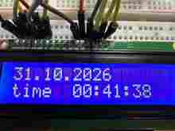
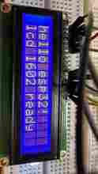
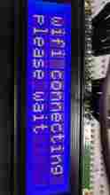
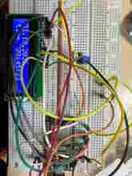
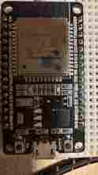
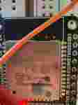
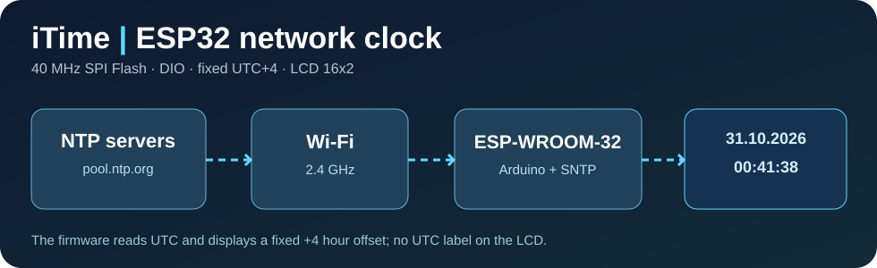

# iTime — от символьных часов до двухэкранного погодного информера

**🇷🇺 Русский · [🇬🇧 English](README.en.md)**

## 🌦️ Последняя стабильная версия — iTime 2.1 (ESP32-S3 + 2 × TFT)

**Проверена на реальном устройстве 04.11.2026.**

Работают интернет-часы UTC+4, два независимых цветных экрана ST7735, погода Самары через OpenWeather, давление в мм рт. ст., локальный HTTP-сервер и веб-панель. Второй экран **показывает погоду 5 минут, а сервер — 5 секунд**. Часы обновляют секунды без постоянного мерцания.

> Первые часы умели показывать время. Вторые научились проверять погоду, чтобы решать, когда лучше не выходить из дома. И всё это после того, как мультиметр напомнил нам, что плохой контакт не лечится новыми библиотеками.

**[📖 Подробное техническое руководство iTime 2.1 — с распиновкой, командами PowerShell, API и историей отладки](docs/itime-2.1/README.md)**  
**[💻 Исходник последней стабильной прошивки](firmware/itime_2_1/itime_2_1.ino)** · **[🛡️ TLS CA](firmware/itime_2_1/openweather_ca.h)** · **[🔐 Пример настроек без секретов](firmware/itime_2_1/secrets.example.h)**

**Важно:** iTime 1.0 (ESP-WROOM-32 и LCD 1602) сохранён ниже без удаления исходников и фотографий. Новости с Ubuntu находятся в плане **iTime 2.2**, а не в этой версии. Никакой магии маркетинга.

---

## 📟 Архив предыдущей стабильной версии — iTime 1.0

# iTime ⏰ — часы, которые победили ESP32 (пока ESP32 не передумала)

**🌐 Язык / Language:** 🇷🇺 Русский · [🇬🇧 English — full documentation](README.en.md)

> **«Всего-то вывести время на экран», — сказали они.**  
> А потом прилетел **Guru Meditation Error**, флеш-память решила заняться экзорцизмом, и микроконтроллер начал перезагружаться с дисциплиной продакшн-сервера в пятницу в 18:00.
>
> **iTime** — настоящие интернет-часы на **ESP-WROOM-32** и символьном ЖКИ **Winstar WH1602A-YGH-CT(K) 16×2**. Подключаются к Wi-Fi, получают время с NTP, показывают дату и часы в **UTC+4**, но не тратят драгоценные 16 символов на надпись «UTC+4». Потому что у дисплея и так теснее, чем в баг-трекере перед релизом.

**Статус:** ✅ пользователь подтвердил работу даты и времени на реальном LCD по фото.  
**Внимание:** рекомендуемый режим прошивки — **SPI Flash 40 MHz + DIO**. При **80 MHz** на проверенном экземпляре ESP32 возникали **IllegalInstruction / LoadStoreAlignment** и бесконечный reboot. Снижение до 40 MHz позволило успешно запустить Wi-Fi. Это наблюдение на одной конкретной плате, а не универсальный диагноз всех ESP32.

## 📸 Настоящие фотографии iTime

Ниже — **реальные снимки моего прототипа**, а не 3D-рендер и не случайные фотографии из интернета. В репозитории находятся облегчённые миниатюры; исходные снимки в полном разрешении сохранены отдельно в архиве испытаний.

### ✅ Часы заработали

**31.10.2026 • 00:41:38.** После нескольких Guru Meditation ESP32 наконец-то согласилась сообщить, сколько времени мы потеряли на её воспитание.

### 🧪 Первый Hello World и зависший Wi-Fi

| LCD работает | Wi-Fi опять «подождите» |
|---|---|
|  |  |
| «Микроволновка наконец выучила две строки». | «Сука, please wait — это не uptime». |

### 🔌 Настоящий макетный стенд и микроконтроллер

| Макетная плата с проводами | ESP32 DevKit | Маркировка ESP-WROOM-32 |
|---|---|---|
|  |  |  |
| «Проводов больше, чем требований у заказчика». | «GPIO16 — это RX2. Не спрашивайте». | «80 МГц? Я лучше упаду». |

*Примечание:* фотографии уменьшены для отображения прямо в README. Они документируют испытательный макет, а не являются электрически проверенной схемой подключения. Полные описания кадров — в [docs/photos.md](docs/photos.md).

Реальный прототип: ESP-WROOM-32 на макетной плате, 16-пиновый параллельный LCD 1602 с синей подсветкой, регулировка контраста потенциометром. На успешном снимке первая строка показывает дату **31.10.2026**, вторая — **time 00:41:38** (показание на момент фотографии). Дата и секунды меняются автоматически.

Подробные подписи к фотографиям — в [фотодневнике](docs/photos.md), распиновка — в [документе о подключении](docs/wiring.md). В GitHub теперь есть **миниатюры всех шести реальных снимков**; оригиналы большего разрешения сохраняются отдельно.

## 🤬 Описание для тех, кто обожает «быстрые проекты на вечер»

«Сделаем часы на ESP32, чё там, пять строк кода». Ага, сука, пять строк. Потом «одна строка квадратиков» на ЖКИ, затем «Wi-Fi connecting» в бесконечном цикле, а потом ESP32 выдаёт **Guru Meditation** с лицом человека, которому пообещали бесплатный отпуск после дедлайна.

Наконец мы сделали то, что умеет любая микроволновка: показывать время. Только наша микроволновка синхронизируется с NTP, умеет печатать IP в serial и требует указывать частоту SPI Flash с точностью патологоанатома. **Плата не сломалась — она просто проходила техническое собеседование с пристрастием.**

Если у тебя «на 80 МГц всё работает» — прекрасно, поздравляем с золотой флешкой. На *этом* экземпляре было иначе. **40 МГц — не «замедление интернета», а частота SPI Flash**, и её нельзя путать со скоростью COM-порта прошивки.

## ✨ Возможности v1

- Интернет-время через NTP: pool.ntp.org и time.google.com.
- **Фиксированный пояс UTC+4** без сезонного перевода часов.
- Первая строка LCD: дата в формате DD.MM.YYYY; вторая: **time HH:MM:SS**.
- Обновление часов без постоянного вызова lcd.clear() и без полного мерцания.
- Автоматическое повторное подключение Wi-Fi.
- Часы продолжают идти после успешной синхронизации при временной потере сети (пока ESP32 работает и хранит текущее время).
- Отладка через serial 115200 baud.
- Настройки Wi-Fi в **secrets.h**, который **исключён из Git**.
- Сборка и прошивка через **PowerShell + Arduino CLI**, порт **COM3** по результатам стендовых испытаний.
- **Никакого** API новостей, погоды и CRMui3 в v1: это честные планы, а не нарисованные фичи.

## 🧩 Железо

| Компонент | В проекте |
|---|---|
| Микроконтроллер | ESP-WROOM-32 на ESP32 DevKit, разъём micro-USB |
| Дисплей | WH1602A-YGH-CT(K), 16×2, 16 контактов, параллельный интерфейс |
| Режим LCD | 4-bit (RS, E, D4…D7) |
| Питание LCD | 5 В, общая земля с ESP32 |
| Контраст | Подстроечный резистор / потенциометр 10 кОм |
| Подсветка | A/K, предварительно 330 Ом последовательно с A; уточнять ток по datasheet |
| Согласование сигналов | Рекомендуется 74HCT245 либо два 74HCT125 на линиях от ESP32 к LCD |
| Сеть | Wi-Fi 2,4 ГГц |

⚠️ На фотографиях реального прототипа монтаж макетный и НЕ является эталонной электрической схемой. ESP32 имеет 3,3-вольтовые GPIO, а ЖКИ запитан от 5 В. Успешный опыт прямого соединения **не доказывает гарантированную совместимость логических уровней**. Для воспроизводимого устройства применяйте согласователь уровней и общий GND.

### Контакты ЖКИ

| LCD | ESP32 / цепь |
|---|---|
| 1 VSS | GND |
| 2 VDD | 5V |
| 3 VO | Средний вывод потенциометра контраста |
| 4 RS | GPIO16 / RX2, через согласователь |
| 5 RW | GND |
| 6 E | GPIO17 / TX2, через согласователь |
| 7–10 D0–D3 | Не подключать |
| 11 D4 | GPIO18, через согласователь |
| 12 D5 | GPIO19, через согласователь |
| 13 D6 | GPIO21, через согласователь |
| 14 D7 | GPIO22, через согласователь |
| 15 A | +5V через резистор подсветки, параметры проверить |
| 16 K | GND |

Провода переставлять **только после отключения USB**. Подробно: [docs/wiring.md](docs/wiring.md).

## 🧱 ПО, ядро и библиотеки

| Компонент | Версия / назначение |
|---|---|
| Windows / PowerShell | Среда управления сборкой |
| Arduino CLI | На испытаниях: **1.5.1** |
| Arduino Core для ESP32 | Платформа **esp32:esp32**; в скрипте предложена фиксированная **3.2.1** для воспроизводимости. Фактически установленную версию своей машины проверьте через core list |
| WiFi.h | Входит в Arduino Core ESP32; сеть и переподключение |
| time.h + configTime() | Системные часы ESP32 и SNTP/NTP |
| LiquidCrystal | Стандартная Arduino-библиотека для HD44780-совместимого параллельного LCD |

Не нужны: отдельная RTC, I²C-переходник, HTTP-клиент погоды, ArduinoJson, CRMui3. **Кириллицу в этой версии не выводим**, потому что LCD — это не UTF-8-терминал. Русские новости потребуют отдельного преобразования в кодировку знакогенератора.

## 🚀 Установка на Windows (PowerShell)

Все команды ниже рассчитаны на каталог **c:\users\zhoric\downloads\itime** и **com3**. Если плата получит другой порт, поменяй параметр -p.

### 1. Получить исходники

~~~powershell
cd c:\users\zhoric\downloads
git clone https://github.com/iXimik/iTime.git itime
cd .\itime
~~~

### 2. Проверить Arduino CLI

~~~powershell
arduino-cli version
arduino-cli board list
~~~

Если команда не находится, но Arduino CLI уже установлен по адресу из испытаний:

~~~powershell
$env:path += ";c:\program files\arduino cli"
arduino-cli version
~~~

Если CLI вообще нет:

~~~powershell
winget install --id ArduinoSA.CLI -e
~~~

### 3. Установить ядро и библиотеку

~~~powershell
arduino-cli config add board_manager.additional_urls https://espressif.github.io/arduino-esp32/package_esp32_index.json
arduino-cli core update-index
arduino-cli core install esp32:esp32@3.2.1
arduino-cli lib install "LiquidCrystal"
arduino-cli core list
~~~

Или воспользоваться [scripts/setup.ps1](scripts/setup.ps1) после установки CLI.

### 4. Заполнить Wi-Fi без публикации пароля

~~~powershell
copy-item .\firmware\itime\secrets.example.h .\firmware\itime\secrets.h
notepad .\firmware\itime\secrets.h
~~~

Заменить только значения кавычек **WIFI_SSID** и **WIFI_PASSWORD**. ESP32 нужен Wi-Fi 2,4 ГГц. Не публикуй secrets.h, скриншот с паролем или логи с секретами в GitHub. Файл специально находится в .gitignore.

### 5. Компиляция с ВАЖНЫМ режимом Flash

~~~powershell
arduino-cli compile --clean --fqbn "esp32:esp32:esp32:FlashFreq=40,FlashMode=dio" .\firmware\itime
~~~

**Обязательные параметры для проверенного экземпляра:**

- **FlashFreq=40** — частота чтения SPI Flash 40 МГц. При 80 МГц возникали исключения CPU.
- **FlashMode=dio** — режим доступа к SPI Flash.
- **fqbn esp32:esp32:esp32** — обобщённая плата ESP32 Dev Module.
- **com3** — последовательный порт; это НЕ частота флеш-памяти.
- **115200 baud** — скорость *serial monitor*. Настройки скорости *передачи прошивки* отдельные, по умолчанию определяются параметрами платы/загрузчика.

### 6. Прошивка

~~~powershell
arduino-cli upload -p com3 --fqbn "esp32:esp32:esp32:FlashFreq=40,FlashMode=dio" .\firmware\itime
~~~

В монитор:

~~~powershell
arduino-cli monitor -p com3 --config baudrate=115200
~~~

Для автоматизации можно использовать [scripts/flash.ps1](scripts/flash.ps1), который сначала компилирует, а потом загружает прошивку. Перед прошивкой последовательный монитор должен быть закрыт.

## 🕒 Как должны выглядеть часы

~~~text
31.10.2026      
time  00:41:38  
~~~

Реальное время зависит от текущего NTP-ответа и фиксированного смещения UTC+4. Дата и время в примере взяты из фотографии, а не из эмулятора.

При включении, пока нет синхронизации:

~~~text
wifi connecting 
please wait     
~~~

Если Wi-Fi есть, но время ещё не получено:

~~~text
ntp syncing     
please wait     
~~~

## 🐛 Как мы поймали баг с Flash

**Наблюдение 1:** статический «hello esp32!» на LCD работал.  
**Наблюдение 2:** при добавлении Wi-Fi произошёл цикл reboot, ошибки **IllegalInstruction** и **LoadStoreAlignment**.  
**Наблюдение 3:** даже со снятым LCD диагностический скетч падал после «boot ok» при старте Wi-Fi.  
**Наблюдение 4:** на **80 МГц** в boot log встречалось **mode:DIO, clock div:1**.  
**Наблюдение 5:** после сборки с **FlashFreq=40,FlashMode=dio** лог показал **mode:DIO, clock div:2** и успешное соединение, IP **192.168.10.21**.  
**Наблюдение 6:** RSSI составлял около **−82…−83 dBm** — слабый Wi-Fi; для ежедневного устройства желательно улучшить приём.

Вывод: понижение частоты Flash **коррелировало с устранением сбоя** на этом экземпляре. Без измерений питания и длительных стресс-тестов нельзя уверенно утверждать, что виновата именно микросхема памяти. Подробности в [docs/diagnostics.md](docs/diagnostics.md).

## 📁 Структура

~~~text
itime/
├── README.md
├── LICENSE                    # MIT; сохранена лицензия репозитория
├── .gitignore
├── firmware/
│   └── itime/
│       ├── itime.ino          # часы и Wi-Fi
│       └── secrets.example.h  # образец, без паролей
├── scripts/
│   ├── setup.ps1              # установка платформы/библиотеки
│   └── flash.ps1              # сборка 40 МГц + загрузка
└── docs/
    ├── overview.svg          # архитектурная иллюстрация
    ├── wiring.md             # подробная проводка
    ├── diagnostics.md        # реальные сбои и решение
    ├── photos.md             # подписи к фотографиям прототипа
    └── roadmap.md            # будущие новости/погода
~~~

## 🛣️ Что дальше

**v1 — готово:** часы + дата + Wi-Fi + NTP + LCD.  
**v2 — план:** погода с сервера.  
**v3 — план:** заголовки новостей из [news_informer_project](https://github.com/iXimik/news_informer_project), бегущая строка и русская кодировка ЖКИ.  
**v4 — план:** веб-панель на базе [CRMui3](https://github.com/WonderCRM/CRMui3) после проверки совместимости с текущим ESP32 Core.

Ничего из v2–v4 в опубликованной прошивке **пока нет**. И это нормально: реальное устройство лучше, чем README с мифическими фичами и пустым main.cpp.

## ⚖️ Лицензия

MIT, оригинальный файл [LICENSE](LICENSE) сохранён. Сторонние библиотеки устанавливаются отдельно и сохраняют собственные лицензии.

**Слава 40 мегагерцам. Пусть больше никакой гуру не медитирует в нашем serial monitor.**
