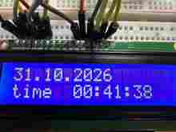
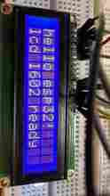
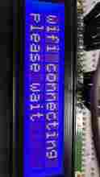
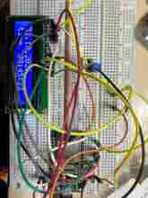
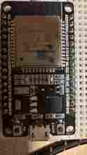
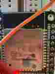

# Фотодневник прототипа iTime

Ниже — **описания шести реальных фотографий**, предоставленных автором проекта во время сборки и испытаний. Это не стоковые картинки и не рендер. Изображения являются пользовательскими материалами. В GitHub опубликованы **облегчённые копии всех шести снимков** в [docs/photos/](photos/) и они показаны прямо в [README](../README.md). Исходные фотографии полного разрешения пока хранятся отдельно. Иллюстрация архитектуры доступна в [overview.svg](overview.svg).

## 1. «Это работает, сука!»: интернет-часы

**Исходное имя:** IMG_A7D40F15-0172-4D77-97B8-1EFF8AE4E932.jpeg

Крупный план включённого LCD 1602 с ярко-синей подсветкой. На верхней строке **31.10.2026**, на нижней — **time 00:41:38**. Дата/время в формате 24 часов, часовой пояс не занимает место на экране. Это фотографическое подтверждение работы NTP-часов.

**Подпись:** «31 октября. Наконец-то программист узнал время. Цена познания — два Guru Meditation и одна потерянная вера в 80 мегагерц».

## 2. «Hello, world. Теперь ты официально программист микроволновки»

**Исходное имя:** IMG_6028(1).jpeg

Первый успешный тест двустрочного дисплея: **hello esp32!** и **lcd 1602 ready**. Подтверждение исправности базового ЖКИ, разъёмов и функций LiquidCrystal.

**Подпись:** «12 букв на дисплее и три часа выяснений, куда делся D6. Добро пожаловать в embedded».

## 3. «Wi-Fi connecting: бесконечность не предел»

**Исходное имя:** IMG_6029(1).jpeg

Экран показывает **wifi connecting / please wait**. Это этап отладки, когда включение сетевой части сопровождалось аварийными перезагрузками ESP32.

**Подпись:** «Wi-Fi connecting. Please wait. Please wait. Please wait. Устройство явно работает в компании, где никто не отвечает за инфраструктуру».

## 4. «Макетная плата — проводной кошмар»

**Исходное имя:** IMG_902697C1-5781-406E-B419-0144888E577D.jpeg

Общий вид стенда сверху: LCD 1602, ESP-WROOM-32, длинные разноцветные перемычки, потенциометр контраста и общая макетная плата. Монтаж опытный, пригоден для документирования, **не** является инструкцией безопасной разводки.

**Подпись:** «Если убрать хотя бы один провод, пропадёт либо время, либо смысл жизни».

## 5. «Где GPIO16, чёрт побери?»

**Исходное имя:** IMG_6024(1).jpeg

Крупный план контроллера ESP-WROOM-32 на DevKit, micro-USB, кнопки EN/BOOT и подписи выводов. На этой плате **RX2 соответствует GPIO16**, а **TX2 — GPIO17**.

**Подпись:** «RX2 звучит как UART, а оказался просто GPIO16. Потому что почему бы не назвать ножку тремя способами».

## 6. «Вот он, красавец, о котором мы спорили»

**Исходное имя:** IMG_BACCE4D8-FEE3-4A53-9D36-494FE59A1B2F.jpeg

Маркировка металлического корпуса модуля **ESP-WROOM-32** и обозначения GPIO на правой стороне платы. Подтверждает аппаратную платформу, на которой воспроизводились проблемы Flash 80 МГц и последующий успех при 40 МГц.

**Подпись:** «На железке написано ESP-WROOM-32, но при старте на 80 МГц она называла себя Guru Meditation».

---

## Как добавить оригинальные фото в репозиторий

Превью уже лежат в каталоге **docs/photos/** и отображаются в README. Если заменять их снимками полного разрешения, используется тот же Markdown:

~~~markdown

~~~

Перед загрузкой снимков в публичный репозиторий проверь отсутствие личных данных, наклеек с серийными номерами и паролей, попавших в кадр.
